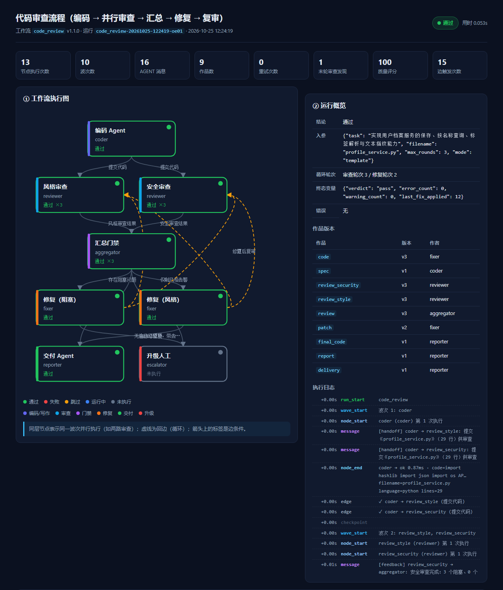
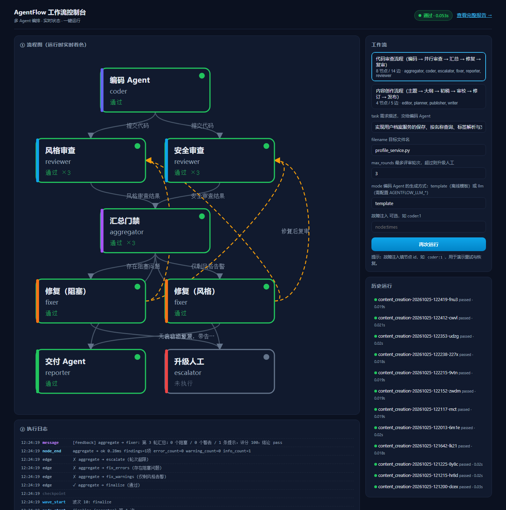
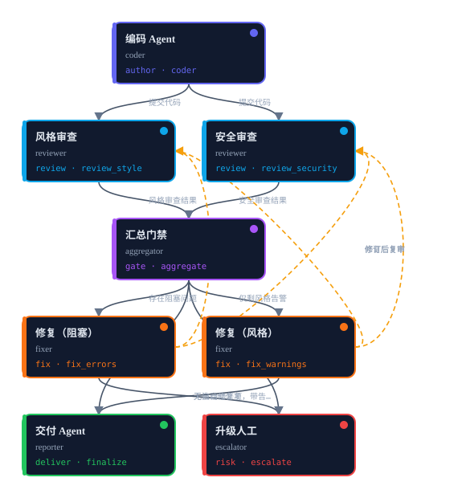
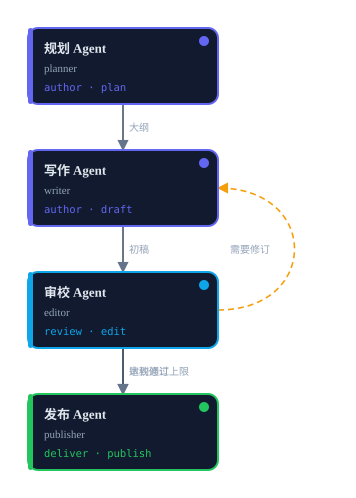

# AgentFlow · 多 Agent 协作工作流引擎

> 一个 2–3 个 Agent（实际 4–6 个）协作、可运行、可扩展、可视化的工作流编排 MVP。
> 选定方向：**代码审查流程（编码 → 审查 → 修复）**，并额外提供**内容创作流程**
> 以证明同一套引擎能承载完全不同的业务。
>
> 纯 Python 标准库实现，**零第三方依赖、离线可复现**，不需要任何 API Key。

---

## 一、30 秒跑起来

```powershell
# Windows PowerShell（本机 Python 3.10+）
python demo.py                     # 跑通两个流程 + 导出流程图
python demo.py --web               # 打开可视化控制台 http://127.0.0.1:7860
python -m unittest discover -s tests -t .   # 50 个测试，约 2 秒
```

```bash
# macOS / Linux
python3 demo.py
python3 -m agentflow run --workflow code_review
```

三条命令分别对应：**能跑通**、**看得到**、**可验证**。

不想跑也能先看效果（仓库内已附示例产物）：

| 直接打开 | 内容 |
| --- | --- |
| [docs/sample/code_review_report.html](docs/sample/code_review_report.html) | 代码审查流程的完整可视化报告（内嵌流程图、消息表、代码 diff） |
| [docs/sample/legacy_billing_review.html](docs/sample/legacy_billing_review.html) | **审查外部文件**的报告（`examples/legacy_billing.py`） |
| [docs/sample/content_creation_report.html](docs/sample/content_creation_report.html) | 内容创作流程的完整可视化报告 |
| [docs/sample/profile_service.py](docs/sample/profile_service.py) | 经过 3 轮审查/修复后的终版代码 |
| [docs/sample/legacy_billing_fixed.py](docs/sample/legacy_billing_fixed.py) | 外部文件被自动修复后的结果（对照 [原文件](examples/legacy_billing.py)） |
| [docs/sample/review_report.md](docs/sample/review_report.md) | 交付 Agent 生成的 Markdown 审查报告 |
| [docs/sample/final_document.md](docs/sample/final_document.md) | 内容流程发布的终稿 |

### 效果预览

一次运行的 HTML 报告（流程图按状态着色、访问次数标 `×N`、右侧完整时间线）：



Web 控制台（`python -m agentflow serve`）；
用 `http://127.0.0.1:7860/?run=<run_id>` 可以直接回放某次历史运行：



---

## 二、它到底做了什么

以 `code_review` 为例，一次真实运行（`python -m agentflow run --workflow code_review`）：

```
▶ 运行 code_review-20261025-121642-3l2d · 代码审查流程
  8 个节点 / 14 条边

[波次 1] coder
  ├─ coder (coder) 开始…
  ✉  [handoff] coder → review_style: 提交《profile_service.py》（29 行）供审查
  │  OK      coder (0.73ms)  filename=profile_service.py lines=29
  ├→ coder → review_style (提交代码)
  ├→ coder → review_security (提交代码)

[波次 2]  ⇉ 并行 review_style, review_security      ← 两路审查同时进行
  │  OK      review_style    findings=13项 error=0 warning=13
  │  OK      review_security findings=3项  error=3 warning=0

[波次 3] aggregate                                  ← join：等两路都完成
  ✉  [feedback] aggregate → fixer: 第 1 轮汇总：3 阻塞 / 13 警告，结论 fail
  ├→ aggregate → fix_errors (存在阻塞问题)

[波次 4] fix_errors                                 ← 只修 severity=error
  │  OK      fix_errors applied=3项  error 3 → 0
  ├→ fix_errors → review_style (修复后复审)
  ├→ fix_errors → review_security (修复后复审)

[波次 5~6] 复审 → 0 阻塞 / 12 警告 → 结论 pass_with_warnings → fix_warnings
[波次 7~9] 修风格 → 复审 → 0 阻塞 / 0 警告 → 结论 pass
[波次 10] finalize → 交付 profile_service.py (v3) + 审查报告

■ 结束：PASSED  用时 0.052s
```

上面这段日志里已经覆盖了课程要求的**全部核心概念**：

| 概念 | 在日志里的样子 | 代码位置 |
| --- | --- | --- |
| 顺序执行 | 波次 1 → 3 → 4 依次推进 | `core/engine.py` 主循环 |
| 并行执行 | 波次 2 两路审查同时跑（`⇉`） | `Engine._run_wave` |
| 条件分支 | `verdict == 'fail'` 才走修复 | 边的 `when` + `core/expr.py` |
| 循环 | 修复后回边再审，最多 3 轮 | 回边 + `max_visits` |
| Agent 通信 | `✉ coder → review_style` 消息 | `core/message.py` |
| 状态共享 | 作品 `code` 从 v1 演进到 v3 | `core/state.py` |
| 错误处理 | 重试、`on_error`、超时、升级人工 | `Engine._run_node` |
| 可观测性 | 波次/节点/边/重试全部进事件流 | `core/trace.py` |

## 三、两个内置工作流

### 1. 代码审查流程 `code_review`（主流程）



8 个节点 / 14 条边，6 个 Agent 参与：`coder` →（`reviewer` ×2 并行）→ `aggregator`
→ `fixer`（分 error / warning 两档）→ `reporter`，异常分支到 `escalator`。

- **并行 fan-out**：编码完成后同时触发风格审查与安全审查，两条边；
- **join 语义**：`aggregate` 用 `needs` 声明依赖，两路都完成后才执行（且只执行一次）；
- **条件分支**：`aggregate` 的 `verdict` 决定走 `fix_errors` / `fix_warnings` / `finalize` / `escalate`；
- **循环**：修复后回到两路复审（回边），用 `review_round` 计数 + `max_visits` 兜底；
- **升级人工**：`iteration >= inputs.max_rounds` 时走 `escalate`，运行状态标记为 `partial`。

一次运行的实际演进（3 轮审查、2 轮修复、代码 v1 → v3）：

| 轮次 | 阻塞 | 警告 | 结论 | 动作 |
| --- | --- | --- | --- | --- |
| 1 | 3 | 13 | `fail` | 修 error（SQL 注入 / 硬编码凭据 / 弱哈希） |
| 2 | 0 | 12 | `pass_with_warnings` | 修 warning（文档、类型标注、可变默认参数…） |
| 3 | 0 | 0 | `pass` | 交付 + 生成报告 |

### 2. 内容创作流程 `content_creation`（可扩展性证据）


4 个节点 / 5 条边，4 个 Agent：`planner` → `writer` → `editor` →（不通过则回边修订）
→ `publisher`。它与代码审查**没有共享任何业务代码**，只复用引擎与 Agent 基类：

- 换业务 → 只写 Agent（`agents/content_agents.py`）；
- 换流程 → 只写 JSON（`workflows/content_creation.json`）；
- 引擎、CLI、报告、Web 控制台一行都不用改。

运行一次：初稿 181 字、6 条阻塞意见 → 定向修订到 668 字 → 审校 `pass`（100 分）→ 发布。

### 3. 审查你自己的代码（不只是内置模板）

编码 Agent 支持三种源码来源：`template`（默认离线模板）、`llm`（真实模型）、
以及**导入你的文件**。所以同一条“审查 → 修复 → 复审”流水线可以直接跑在现存代码上：

```powershell
# 审查任意 Python 文件（最短写法）
python -m agentflow run --workflow code_review --target examples/legacy_billing.py

# 等价写法 + 补充说明
python -m agentflow run --workflow code_review `
  --input path=src/billing.py --input mode=file --input task="审查计费模块的安全问题"

# 也可以直接审查一段内联代码
python -m agentflow run --workflow code_review --input "source=import hashlib`ndef h(t):`n    return hashlib.md5(t.encode()).hexdigest()"
```

产物在 `runs/<run_id>/artifacts/` 下（`legacy_billing.py` + `final_legacy_billing.py` +
`review_report.md`），**不会修改你的原文件**；报告标题、diff 与文件名都会用你的真实文件名。

实测（`examples/legacy_billing.py`，40 行、10 处典型缺陷）：3 轮审查、2 轮修复、
阻塞 3→0、评分 25→100，SQL 拼接改成参数化查询、硬编码 token 改成环境变量、
`sha1` 改 `sha256`、补文档与类型标注。

> 注意：审查能力来自**规则包**（14 条 AST 规则），所以它只会发现规则覆盖到的模式。
> 想覆盖更多模式就加规则（`@rule`）和修复（`@fixer`），见第五章扩展指南。
> 目前一次审查一个文件；要审整个仓库可以用脚本遍历目录后逐个 `--target`。

---

## 四、架构一页图

```
                     ┌──────────────────────────────────┐
                     │        CLI  /  Web 控制台         │  cli.py · web/server.py
                     └───────────────┬──────────────────┘
                                     │ run(workflow, inputs)
                     ┌───────────────▼──────────────────┐
                     │             Engine               │  波次调度 / 条件 / 循环
                     │  条件求值 · 重试 · 超时 · 断点恢复  │  core/engine.py
                     └──┬──────────────┬────────────┬───┘
        ┌───────────────┘              │            └────────────────┐
┌───────▼────────┐        ┌────────────▼────────────┐     ┌──────────▼─────────┐
│ WorkflowSpec   │        │      SharedState        │     │       Tracer       │
│ nodes + edges  │        │ 作品(带版本) / 变量 / 计数 │     │ events.jsonl      │
│ core/graph.py  │        │    MessageBus(消息)      │     │ report.html        │
└───────┬────────┘        └────────────┬────────────┘     └────────────────────┘
        │ 声明式 JSON                   │ AgentContext
┌───────▼────────┐        ┌────────────▼────────────┐
│ workflows/*.json│       │  Agents（@register_agent）│  coder / reviewer / fixer
│ 改流程不改代码   │       │  输入 dict → 输出 dict    │  planner / writer / editor
└────────────────┘        └─────────────────────────┘
```

三条数据通道（这是“Agent 协作”的关键）：

| 通道 | 内容 | 为什么这样设计 |
| --- | --- | --- |
| **作品仓库**（Artifact） | 代码、审查结论、文稿等大对象，**带版本历史** | 支持 diff、回滚、报告里看演进；并行分支各写各的作品，无冲突 |
| **变量黑板**（Variables） | `verdict`、`iteration`、`review_round` 等标量 | 供边上的 `when` 条件读取，实现分支与循环 |
| **消息总线**（MessageBus） | `handoff` / `feedback` / `escalation` / `result` | 留下可审计的协作轨迹，报告里有完整对话表 |

> 详细设计见 [docs/ARCHITECTURE.md](docs/ARCHITECTURE.md)。

---

## 五、作业要求对照

### 必须实现

| 要求 | 实现情况 | 证据 |
| --- | --- | --- |
| 至少 2 个 Agent 协作完成完整流程 | ✅ 主流程 6 个 Agent、11 个已注册 Agent | `agentflow/agents/`、`python -m agentflow list` |
| Agent 间消息传递或状态共享 | ✅ 两者都有：消息总线 + 版本化作品仓库 + 变量黑板 | `core/message.py`、`core/state.py`，报告“Agent 协作”一栏 |
| 基本流程控制（顺序执行） | ✅ 波次调度，顺序/并行/分支/循环统一处理 | `core/engine.py` |
| MVP 可运行 | ✅ 零依赖，`python demo.py` 一条命令 | 50 个测试通过 |

### 推荐实现（全部做了）

| 要求 | 实现情况 |
| --- | --- |
| 条件分支 | ✅ 边上的 `when` 表达式（安全 AST 求值，禁用 `eval`） |
| 循环 | ✅ 回边 + 轮次计数 + `max_visits` 死循环保护 + 超限升级人工 |
| 并行执行 | ✅ 同一波次内线程池并行 + `needs` 声明的 join 语义 |
| 可视化编排界面 | ✅ **离线 HTML 报告**（内嵌 SVG 流程图 + 时间线）与 **Web 控制台**（实时着色、一键运行、历史记录） |
| 执行日志与状态追踪 | ✅ 结构化事件流 `events.jsonl`（9 类事件）+ `summary.json` + 终端彩色日志 |
| 错误处理与恢复 | ✅ 节点级重试（指数退避）/ 超时 / `on_error=skip` 降级边 / 升级人工 / **断点续跑** `resume` |

### 评分维度自检

| 维度 | 权重 | 本项目的证据 |
| --- | --- | --- |
| 流程完整性 | 40% | 主流程端到端跑通并收敛（3 轮审查 → 0 阻塞 0 警告 → 交付 v3 代码）；`tests/test_pipeline.py` 断言了 7 项完整性不变式 |
| Agent 协作 | 30% | 16 条消息的完整协作轨迹；作品版本化（v1→v3）；join/回边靠状态代数判定；并行分支互不干扰 |
| 可扩展性 | 20% | 第二个流程零改动复用引擎；规则与修复都是注册表；`AGENTFLOW_AGENTS` 支持外部插件；新流程只写 JSON |
| 文档 | 10% | README + 架构说明 + 流程图（SVG/Mermaid）+ 使用手册 + 代码内中文注释 |

---

## 六、目录结构

```
ai homwork2/
├── demo.py                     # 一键演示（两个流程 + 导出流程图 + 可选控制台）
├── examples/
│   └── legacy_billing.py       # 演示「审查你自己的代码」用的历史遗留模块
├── README.md                   # 本文件
├── agentflow/
│   ├── __init__.py             # 对外 API：Engine / WorkflowSpec / register_agent ...
│   ├── __main__.py             # python -m agentflow
│   ├── cli.py                  # 命令行：list / validate / run / resume / visualize / serve
│   ├── core/
│   │   ├── engine.py           # 调度引擎（波次/分支/循环/并行/重试/断点）
│   │   ├── graph.py            # 工作流 DSL：NodeSpec / EdgeSpec / 校验 / 输入引用解析
│   │   ├── agent.py            # BaseAgent / AgentContext / AgentRegistry
│   │   ├── state.py            # SharedState + 带版本作品仓库
│   │   ├── message.py          # MessageBus（不可变消息 + 完整历史）
│   │   ├── expr.py             # 安全表达式求值（白名单 AST，非 eval）
│   │   ├── trace.py            # 事件追踪 + 终端输出
│   │   ├── layout.py           # 流程图分层布局（DFS 找回边 + 拓扑分层）
│   │   └── report.py           # 单文件 HTML 报告（内嵌 SVG）
│   ├── agents/
│   │   ├── code_agents.py      # 编码/审查/汇总/修复/交付/升级 Agent
│   │   ├── content_agents.py   # 规划/写作/审校/发布 Agent
│   │   ├── linting.py          # 14 条 AST 审查规则（规则注册表）
│   │   ├── codemods.py         # 10 类自动修复（rule_id → 变换函数）
│   │   └── llm.py              # 可选的真实 LLM 接入（OpenAI 兼容）
│   ├── workflows/
│   │   ├── code_review.json    # 主流程（声明式，可编辑）
│   │   └── content_creation.json
│   └── web/server.py           # Web 控制台（实时流程图 + 一键运行）
├── tests/                      # 45 个 unittest 用例
├── docs/                       # 架构 / 流程图 / 使用手册 + 导出的 SVG
└── runs/                       # 每次运行的产物（自动生成）
    └── <run_id>/
        ├── report.html         # ★ 单文件可视化报告（双击即可看）
        ├── summary.json        # 运行摘要
        ├── state.json          # 完整状态快照（含作品历史）
        ├── events.jsonl        # 结构化事件流
        ├── checkpoint.json     # 断点（可 resume）
        ├── workflow.json       # 本次使用的工作流定义（可追溯）
        └── artifacts/          # 终版代码 / 审查报告 / 各版本代码
```

---

## 七、扩展：三种改法都不碰引擎

### 1. 新增一个 Agent

```python
from agentflow.core.agent import AgentContext, AgentResult, BaseAgent, register_agent

@register_agent
class SecurityExpertAgent(BaseAgent):
    name = "security_expert"          # 工作流 JSON 里用这个名字引用
    inputs = ("code",)
    outputs = ("risks",)

    def run(self, ctx: AgentContext, inputs) -> AgentResult:
        ctx.log("开始专家评审")
        ctx.send("aggregator", "feedback", {"summary": "发现 2 个风险点"})
        return AgentResult(outputs={"risks": [...]})
```

然后工作流里加一个节点 `{"id": "expert", "agent": "security_expert", "inputs": {"code": "artifacts.code"}}` 即可。

### 2. 新增一条审查规则（含自动修复）

```python
@rule("todo-comment", category="style", severity="warning",
      message="源码中残留 TODO", hint="上线前清理 TODO")
def check_todo(tree, source):
    ...

@fixer("todo-comment")
def fix_todo(tree, finding, parents, ctx):
    ...
```

规则与修复都进注册表，审查 Agent、修复 Agent、报告自动生效。

### 3. 新增一条流程

复制 `workflows/code_review.json` 改节点/边即可；`python -m agentflow validate --workflow 新id`
会做静态校验（节点存在性、Agent 是否注册、表达式语法、可达性）。

更多例子与字段说明见 [docs/USAGE.md](docs/USAGE.md)。

---

## 八、验证方式

```powershell
python -m unittest discover -s tests -t .     # 50 个用例
python -m agentflow validate --workflow code_review
python -m agentflow run --workflow code_review --fault coder:1   # 故障注入 → 重试成功
python -m agentflow run --workflow code_review --input max_rounds=1   # 轮次不足 → 升级人工
python -m agentflow resume --run-id <失败的 run_id>               # 断点续跑
python -m agentflow visualize --workflow code_review --out docs/assets/code_review.svg
```

测试覆盖：表达式安全（拒绝 `__import__`/lambda/推导式）、图校验、顺序/分支/并行/循环、
重试/跳过/死循环保护/输出契约、断点恢复、两个流程的端到端收敛、审查规则、自动修复、
布局与 SVG、报告生成。

---

## 九、已知限制（诚实清单）

1. **Agent 默认是规则驱动而非大模型**：为了让作业在任何机器上离线、确定性复现，
   编码 Agent 用模板生成“朴素首版”，审查用 AST 规则。**接入真实 LLM 的插槽已留好**
   （`agents/llm.py` + `CoderAgent` 的 `mode=llm`），配置三个环境变量即可切换。
   自动修复因此会“看起来太强”——但它的每一步都有规则 id 可追溯，不是黑盒。
2. **自动修复用 AST 重写**，会丢失原文件的注释；修复后会 `compile()` 校验，失败则回退原文。
3. **波次之间是栅栏**：同一波次内并行，波次之间串行等待。对本作业的 DAG 足够；
   若未来需要“无栅栏”的连续调度，可把 `_run_wave` 换成工作池 + 条件变量。
4. **超时**用线程实现，超时后线程无法强制终止（Python 限制），会记录告警。
5. **Web 控制台是单进程内存态**：运行会话在重启后清空（历史运行仍从 `runs/` 读取）。
6. **状态存在单机内存 + JSON 文件**，没有引入数据库/消息中间件——MVP 的刻意取舍。

---

## 十、文档索引

| 文档 | 内容 |
| --- | --- |
| [README.md](README.md) | 快速开始、能力总览、要求对照 |
| [docs/ARCHITECTURE.md](docs/ARCHITECTURE.md) | 分层架构、调度算法、状态机、错误处理、设计权衡 |
| [docs/WORKFLOWS.md](docs/WORKFLOWS.md) | 两个流程的完整流程图（Mermaid）、边条件表、时序说明 |
| [docs/USAGE.md](docs/USAGE.md) | CLI 全部命令、工作流 JSON 字段参考、自定义 Agent、接入 LLM、FAQ |

运行产物里的 `report.html` 本身就是一份可视化文档（流程图 + 时间线 + 消息表 + 代码 diff）。
