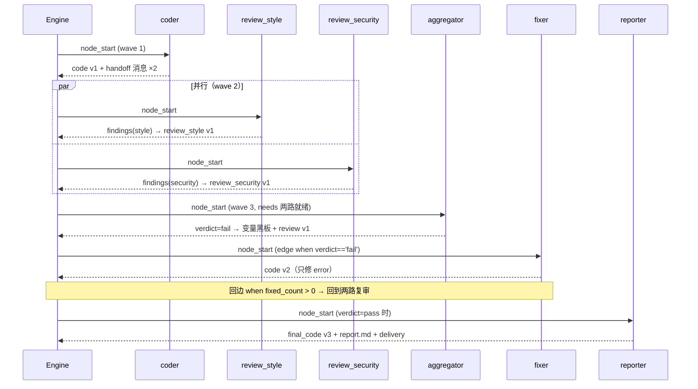

# 架构说明

> 目标：用尽量少的代码把“多 Agent 协作 + 工作流编排 + 状态管理”讲清楚，
> 并且做到**能跑、能看、能扩展**。本文档说明分层、数据模型、调度算法、
> 通信协议、错误处理与关键设计权衡。

---

## 1. 设计目标与约束

| 约束 | 决策 |
| --- | --- |
| 作业需要在任何机器上复现 | 纯标准库；默认离线规则驱动，不依赖 API Key |
| 演示必须“看得见” | 每次运行生成单文件 HTML 报告（内嵌 SVG 流程图）；另有 Web 控制台实时着色 |
| 流程要能改而不改代码 | 流程用 JSON 声明（`workflows/*.json`），带静态校验 |
| 要体现“Agent 协作” | 显式消息总线 + 版本化作品仓库 + 变量黑板，三者职责分离 |
| 必须是 MVP 规模 | 核心运行时约 1200 行代码，无框架、无中间件 |

## 2. 分层架构

```
┌─────────────────────────────────────────────────────────────────────┐
│ 接口层      cli.py（6 个子命令）        web/server.py（REST + 轮询）  │
├─────────────────────────────────────────────────────────────────────┤
│ 编排层      graph.py（DSL/校验/引用解析）   report.py + layout.py     │
├─────────────────────────────────────────────────────────────────────┤
│ 运行层      engine.py（调度/重试/断点）    trace.py（事件流）          │
│             state.py（状态/作品）          message.py（消息）          │
│             expr.py（安全求值）            agent.py（契约/注册表）     │
├─────────────────────────────────────────────────────────────────────┤
│ 执行层      agents/code_agents.py   agents/content_agents.py          │
│             agents/linting.py（规则）  agents/codemods.py（修复）      │
│             agents/llm.py（可选真实模型）                              │
└─────────────────────────────────────────────────────────────────────┘
```

依赖方向严格单向：**执行层只依赖 `agent.py` 暴露的 `AgentContext`**。
Agent 不 import 引擎，因此可以被单元测试直接调用，也可以被换成 LLM 实现。

| 模块 | 职责 | 关键类型 |
| --- | --- | --- |
| `core/graph.py` | 工作流定义、静态校验、输入引用解析、加载/保存 | `WorkflowSpec` `NodeSpec` `EdgeSpec` `RetryPolicy` |
| `core/engine.py` | 波次调度、条件判定、重试、超时、断点、产物落盘 | `Engine` `RunResult` `_Runtime` |
| `core/agent.py` | Agent 契约、注册表、执行上下文门面 | `BaseAgent` `AgentResult` `AgentContext` `AgentRegistry` |
| `core/state.py` | 共享状态、带版本作品仓库、表达式上下文 | `SharedState` `Artifact` `NodeRun` |
| `core/message.py` | 不可变消息 + 线程安全总线 + 历史 | `Message` `MessageBus` |
| `core/expr.py` | 白名单 AST 表达式求值（禁用 `eval`） | `safe_eval` `compile_expression` |
| `core/trace.py` | 结构化事件流 + 终端输出 | `Tracer` |
| `core/layout.py` | 分层图布局（DFS 找回边 + 拓扑分层） | `Layout` `NodeBox` |
| `core/report.py` | 单文件 HTML 报告（SVG + 时间线 + 表格） | `build_report` `render_graph_svg` |
| `web/server.py` | 控制台：列流程/运行/轮询/实时 SVG | `RunManager` `RunSession` `Handler` |

## 3. 数据模型

### 3.1 工作流（声明式）

```jsonc
{
  "id": "code_review",
  "start": "coder",
  "inputs":   { "task": { "type": "string", "required": true, "default": "..." } },
  "defaults": { "max_visits": 12, "timeout_s": 30, "on_error": "fail",
                "retry": { "max_attempts": 1 } },
  "settings": { "parallelism": 4, "max_steps": 60 },
  "nodes": [
    { "id": "coder", "agent": "coder",
      "inputs": { "task": "inputs.task" },          // 引用，运行时解析
      "params": { "mode": "template" },              // 字面量配置
      "outputs": ["code", "filename"],               // 输出契约（缺失即失败）
      "retry": { "max_attempts": 2, "backoff_ms": 50 },
      "max_visits": 1, "timeout_s": 30, "on_error": "fail" },
    { "id": "aggregate", "agent": "aggregator",
      "needs": ["review_style", "review_security"] } // join 声明
  ],
  "edges": [
    { "from": "aggregate", "to": "fix_errors", "when": "verdict == 'fail'",
      "label": "存在阻塞问题" },
    { "from": "aggregate", "to": "escalate",
      "when": "verdict != 'pass' and iteration >= inputs.max_rounds",
      "exclusive": true }                            // 命中后不再评估后续边
  ]
}
```

* **节点** 是“Agent 的一次调用”，同一个 Agent 类可以出现多次（两路 `reviewer`）。
* **边** 是“控制流的转移”，`when` 为真才触发；`on` 决定在 `success`/`skip` 状态下才考虑。
* `exclusive` 边命中后立即停止评估同一源节点的后续边 —— 等价于“优先级最高的分支”，
  用来表达“轮次超限就升级，不要再去修”。

### 3.2 输入引用解析

| 写法 | 含义 |
| --- | --- |
| `inputs.task` | 运行入参 |
| `vars.verdict` | 变量黑板 |
| `artifacts.code` | 作品内容 |
| `nodes.aggregate.findings` | 某节点最近一次输出 |
| `counters.iteration` | 计数器 |
| `literal:error` | 字面量（避免歧义） |
| `code` | 裸名，按 `inputs → vars → counters → 作品 → 节点输出` 顺序回退 |
| `{"ref": "nodes.edit.notes", "default": []}` | **可选输入**：首次进入循环时上游还没产出，用默认值 |

解析失败会抛 `InputResolutionError`，并带上“节点 id / 键名 / 可用字段”，方便定位。

### 3.3 运行时状态

```python
SharedState:
    inputs / variables / counters
    artifacts: dict[str, Artifact]     # 带 history，每次写入 +1 版本
    node_runs: list[NodeRun]           # 每次节点执行的记录（visit/attempt/耗时/输出）
    bus: MessageBus                    # 消息历史
    status / error / notes
```

`Artifact` 的版本历史是**报告里 diff 与“评审轮次演进”表的数据来源**：

```python
Artifact(name="code", content="...", version=3,
         history=[{version:1, content:"...", author:"coder"},
                  {version:2, content:"...", author:"fixer"},
                  {version:3, content:"...", author:"fixer"}])
```

## 4. 调度算法

核心是 **带依赖代数（generation）的波次循环**。

```
frontier = [start]
while frontier:
    wave += 1
    if step > max_steps: raise FlowControlError      # 第二重死循环保护
    ready = [n for n in frontier if deps_satisfied(n)]
    if not ready: raise DeadlockError                # 有等待但永远等不到
    frontier -= ready
    check max_visits(ready)                          # 第一重死循环保护
    outcomes = run_wave(ready)                       # 单节点串行 / 多节点线程池并行
    for n, outcome in outcomes:
        gen[n] += 1; visits[n] += 1
        seen[n] = {need: gen[need] for need in needs(n)}
        fire_edges(n, on="success" if outcome.ok else "skip")
        if outcome.failed: 回滚 gen/visits、把 n 放回 frontier、记录 fatal
    checkpoint()                                     # 每波次落盘（断点）
    if fatal: raise _NodeFailure
```

### 4.1 join 判定为什么用“代数”而不是入度

循环场景下入度计数会失真（同一节点被反复激活）。代数语义是：

> 节点 `n` 的每个 `need` 依赖，**必须在我上次执行之后又完成过一次**。

```python
def deps_satisfied(n):
    return all(gen[need] > seen[n].get(need, 0) for need in node(n).needs)
```

这样 `aggregate` 在第一轮等两路审查，第二轮修复后又能正确等两路复审，不会重复执行。
测试 `test_parallel_fanout_and_join` 断言 `join` 在首轮只执行一次。

### 4.2 回边与循环

回边 = “指向祖先节点的边”。`compute_layout` 里用 DFS 识别它们（仅用于画图）；
调度器不区分回边，靠 **`max_visits`** 和 **边上的 `when`（如 `iteration < 3`）** 保证收敛：

```jsonc
{"from": "fix_errors", "to": "review_style", "when": "fixed_count > 0", "label": "修复后复审"}
```

若真有环且条件恒为真，会在激活时抛 `FlowControlError`（`max_visits`），
运行状态记为 `failed` 并保留断点，报告里能看到停在哪。

### 4.3 并行与吞吐

一个波次内所有 ready 节点丢进 `ThreadPoolExecutor`；结果按声明顺序收集，
以保证**事件顺序确定性**（并行节点完成顺序不固定，但后续边判定顺序固定）。
`settings.parallelism` 控制并发上限，`--parallelism` 可临时覆盖。

## 5. 状态管理与断点恢复

| 时机 | 动作 |
| --- | --- |
| 运行开始 | 写 `workflow.json`（本次流程定义，保证可追溯） |
| 每个波次结束 | **原子写** `state.json`（完整状态 + 作品历史）与 `checkpoint.json`（调度器簿记：`gen/seen/visits/frontier/wave/step`） |
| 运行结束 | `summary.json` + `events.jsonl` + `artifacts/` + `report.html` |

`resume` 的语义：

1. 读回 `workflow.json` → `WorkflowSpec`，`state.json` → `SharedState`，`checkpoint.json` → `_Runtime`；
2. 失败节点在失败时已被“回滚一格并放回 frontier”，因此续跑会重试它；
3. 事件流续写在同一份 `events.jsonl` 上（先读回历史事件）。

## 6. Agent 通信协议

消息是**不可变值对象**，写入后只追加；`MessageBus` 用 `RLock` 保护，支持并行分支同时写入。

| 类型 | 方向 | 用途 |
| --- | --- | --- |
| `handoff` | 上游 → 下游 | “产物交给你了”（附作品名、行数、轮次） |
| `feedback` | 审查方 → 修复方/汇总方 | “发现 N 个问题，结论 X” |
| `result` | 交付方 → `user`（虚拟收件人） | 最终交付摘要 |
| `escalation` | 任意 → `*` | 需要人工介入 |
| `note` / `event` / `task` | 通用 | 说明 / 引擎事件 / 任务派发 |

**何时用消息、何时用作品？** 规则很简单：

* 大对象、需要版本与 diff → **作品仓库**（代码、审查结果、文稿）；
* 标量与决策 → **变量黑板**（`verdict`、`iteration`）；
* 谁对谁说了什么 → **消息总线**（可审计的协作轨迹，报告里成表）。

发送者记录为**节点 id** 而不是 Agent 名 —— 因为同一个 `reviewer` 会并行出现两次，
用节点 id 才能区分“谁在说话”。

## 7. 错误处理与恢复

```
Agent 抛出 AgentExecutionError / OutputValidationError / 超时
   ├─ 节点 retry.max_attempts 未用完 → 指数退避后重试（事件 retry）
   └─ 重试用完
        ├─ on_error = "skip"  → 节点标记 skipped，触发 on="skip" 的边（降级/兜底）
        └─ on_error = "fail"  → 记录 fatal，本波次其余节点结果照常落盘 → 运行 failed

流程级异常（FlowControlError / DeadlockError / GraphValidationError）
   └─ 运行 failed，error 字段写明原因（如“达到 max_visits=2 上限”），断点可用 resume 续跑
```

异常分层见 `core/errors.py`：只有 `AgentExecutionError` 子类被判定为“可重试”，
`RuntimeError` 这类则直接失败，避免把代码 bug 当成临时故障反复重试。

可选的故障注入（`--fault coder:1`）在 `Engine._fault_due()` 里模拟第一次失败，
用于演示重试路径；`tests/test_core.py::test_fault_injection_triggers_retry` 覆盖。

## 8. 安全设计

* **表达式不用 `eval`**：`core/expr.py` 基于 `ast` 白名单求值，只允许字面量、比较、
  布尔/算术运算、三元表达式、点号路径，以及 `len/min/max/sum/abs/any/all/int/str/float/bool/round`
  与三个字符串助手；`__import__`、lambda、推导式、赋值、属性写一律拒绝。
  单测 `test_rejects_arbitrary_code` 覆盖 5 种注入尝试。
* **工作流静态校验**：节点/边引用、Agent 是否注册、`when` 语法、`needs` 引用、可达性。
* **Web 控制台**：只读 API（除“启动一次运行”），报告文件按 `run_id` 白名单式解析并做
  `resolve()` 前缀校验，防目录穿越；没有任何删除/写文件接口。
* **修复后校验**：`codemods.apply_fixes` 重写源码后必须 `compile()` 通过，否则回退原文并如实上报。

## 9. 可观测性

事件类型（写入 `events.jsonl`，同时喂给终端、报告、Web 轮询）：

```
run_start / run_resumed / wave_start / node_start / node_end / edge / edge_exclusive
retry / message / checkpoint / error / run_end
```

`report.html` 的六个区块：执行图（状态着色）→ 运行概览 → Agent 协作（消息表）
→ 审查发现与修复 → 作品与代码演进（diff/版本）→ 原始数据（summary/工作流/状态/事件）。
所有内容内嵌，**离线可看**。

## 10. 扩展点（都不需要改引擎）

| 扩展 | 做法 | 涉及文件 |
| --- | --- | --- |
| 新增 Agent | `@register_agent` 装饰一个 `BaseAgent` 子类；或 `registry.add(instance)`；或设 `AGENTFLOW_AGENTS=my_pkg.agents` | 你的模块 |
| 新增审查规则 | `@rule(rule_id, category=..., severity=...)` 返回 `Finding` | `agents/linting.py` 或你的模块 |
| 新增自动修复 | `@fixer(rule_id)` 对 AST 做定点变换 | `agents/codemods.py` 或你的模块 |
| 新增流程 | 新建/复制 `workflows/*.json`，`validate` 校验 | `workflows/` |
| 换真实 LLM | 设 `AGENTFLOW_LLM_*`，节点 `params.mode=llm`；或自定义 Agent 调用 `get_provider()` | `agents/llm.py` |
| 换报告样式 | 复用 `render_graph_svg`，改造 `build_report` | `core/report.py` |

## 11. 关键设计权衡

| 选择 | 备选 | 为什么这样选 |
| --- | --- | --- |
| **波次栅栏**调度 | 连续工作池 / 事件驱动 | join 语义与“并行分支”最容易讲清、最易断言；对本作业的 DAG 吞吐足够。代价：独立分支会被同波次的慢节点拖住 |
| **JSON 声明式流程** | Python DSL / 代码即流程 | 便于静态校验、可视化、未来做拖拽编辑器；代价：表达式能力受限（这是安全性的收益） |
| **内存状态 + JSON 快照** | SQLite / Redis | 零依赖、可读、可 git diff；代价：无并发多实例共享 |
| **默认规则驱动 Agent** | 全部走 LLM | 作业要能离线复现；LLM 作为可选插槽而非必需依赖 |
| **消息不消费**（保留全历史） | 队列 + 消费确认 | 目标是“可审计 + 可回放”，不是任务分发 |
| **作品带版本** | 只存最新值 | diff、评审轮次演进、回滚都靠它；实现成本很低 |

## 12. 一次运行的时序（代码审查流程）


