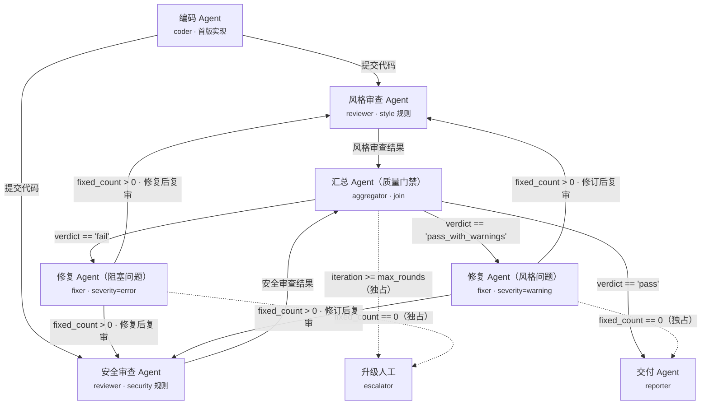
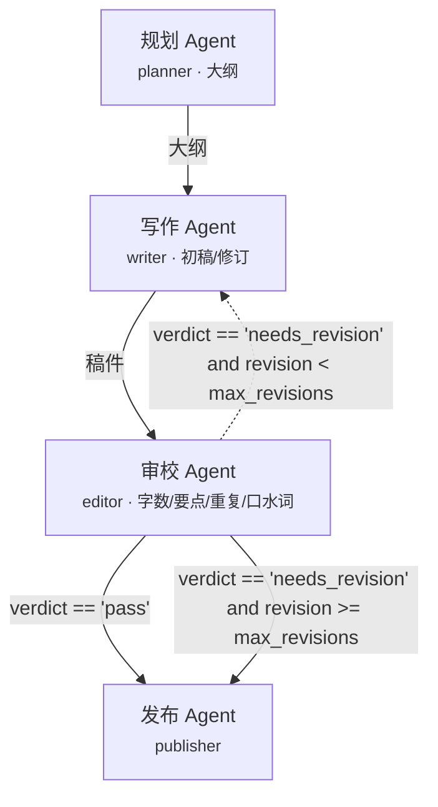

# 流程图与流程说明

本文件给出两个内置工作流的完整流程图、全部边条件、以及一次真实运行的波次轨迹。
导出的静态图在 `docs/assets/`，运行报告里的图会**按实际状态着色**（通过=绿、跳过=黄、
失败=红、未执行=灰），并把访问次数标成 `×N`。

---

## 1. 代码审查流程 `code_review`

### 1.1 流程图




> 实线 = 前进边，虚线 = 回边（循环）或升级/终止分支。

### 1.2 节点表（8 个）

| 节点 id | Agent | 名称（图上显示） | 输入 | 输出 | 特殊配置 |
| --- | --- | --- | --- | --- | --- |
| `coder` | `coder` | 编码 Agent | `inputs.task`, `inputs.filename`, `inputs.path`, `inputs.source`, `inputs.mode` | code, filename, language, lines, generator | `max_visits=1`，重试 2 次；`path`/`source` 存在时直接导入外部源码 |
| `review_style` | `reviewer` | 风格审查 | `artifacts.code` | findings, error/warning/info_count, verdict, score | `categories=["style"]` |
| `review_security` | `reviewer` | 安全审查 | `artifacts.code` | 同上 | `categories=["security"]` |
| `aggregate` | `aggregator` | 汇总门禁 | `artifacts.review_style`, `artifacts.review_security` | findings, verdict, score, by_rule, iteration | **`needs` 两路审查**（join） |
| `fix_errors` | `fixer` | 修复（阻塞） | `artifacts.code`, `nodes.aggregate.findings` | code, applied, fixed_count, remaining_* | `severity=["error"]` |
| `fix_warnings` | `fixer` | 修复（风格） | 同上 | 同上 | `severity=["warning"]` |
| `finalize` | `reporter` | 交付 Agent | code, findings, `vars.verdict`, task, filename | report_md, verdict, score, final_code | `max_visits=1` |
| `escalate` | `escalator` | 升级人工 | findings, `vars.verdict` | escalated, reason, todo | `max_visits=1` |

### 1.3 边表（14 条）

| # | from → to | 条件 `when` | 标签 | 类型 |
| --- | --- | --- | --- | --- |
| 1 | coder → review_style | — | 提交代码 | 顺序 + fan-out |
| 2 | coder → review_security | — | 提交代码 | 顺序 + fan-out |
| 3 | review_style → aggregate | — | 风格审查结果 | join 输入 |
| 4 | review_security → aggregate | — | 安全审查结果 | join 输入 |
| 5 | aggregate → escalate | `verdict != 'pass' and iteration >= inputs.max_rounds` | 轮次超限 | **独占** |
| 6 | aggregate → fix_errors | `verdict == 'fail'` | 存在阻塞问题 | 条件分支 |
| 7 | aggregate → fix_warnings | `verdict == 'pass_with_warnings'` | 仅剩风格告警 | 条件分支 |
| 8 | aggregate → finalize | `verdict == 'pass'` | 通过 | 条件分支 |
| 9 | fix_errors → escalate | `fixed_count == 0` | 无法自动修复 | **独占** |
| 10 | fix_errors → review_style | `fixed_count > 0` | 修复后复审 | 回边（循环） |
| 11 | fix_errors → review_security | `fixed_count > 0` | 修复后复审 | 回边（循环） |
| 12 | fix_warnings → finalize | `fixed_count == 0` | 无自动修复项，带告警交付 | **独占** |
| 13 | fix_warnings → review_style | `fixed_count > 0` | 修订后复审 | 回边（循环） |
| 14 | fix_warnings → review_security | `fixed_count > 0` | 修订后复审 | 回边（循环） |

**边的求值规则**：按声明顺序逐条求值；`when` 为空即命中；`exclusive: true` 的边一旦命中，
该节点剩余的出边不再评估（因此“轮次超限”“无法修复”“带告警交付”这类兜底分支放在前面）。

### 1.4 一次真实运行的波次轨迹

| 波次 | 节点 | 关键结果 |
| --- | --- | --- |
| 1 | coder | 生成 `profile_service.py`（29 行），发现 3 error / 13 warning |
| 2 | review_style ∥ review_security | 风格 13 warning、安全 3 error（并行） |
| 3 | aggregate | verdict=`fail`，合并 16 项发现，评分 25 |
| 4 | fix_errors | 修复 3 项，code v1 → v2（error 3→0） |
| 5 | review_style ∥ review_security | 0 error / 12 warning |
| 6 | aggregate | verdict=`pass_with_warnings`，评分 64 |
| 7 | fix_warnings | 修复 12 项，code v2 → v3 |
| 8 | review_style ∥ review_security | 0 error / 0 warning / 1 info（info 不阻塞） |
| 9 | aggregate | verdict=`pass`，评分 100 |
| 10 | finalize | 交付 v3 + `review_report.md` + `delivery` |

耗时约 50ms（规则审查是毫秒级）；**同样的流程换成 LLM Agent 也完全成立**，
只是每个节点的耗时从毫秒变成秒级。

### 1.5 分支与循环为什么一定能收敛

1. 每轮 `aggregate` 都会 `ctx.incr("review_round")`，`when` 与升级边都读这个计数器；
2. 修复 Agent 每次只处理**当前仍然存在**的发现（重新分析源码，不信任过期清单），
   且 `fixed_count == 0` 时不再回边，避免“空转循环”；
3. `max_visits`（reviewer 10 次、fixer 4 次）与 `settings.max_steps` 是最后两道保险；
4. 实测：3 轮审查 + 2 轮修复收敛；即便规则改得更严，也会在第 3 轮后升级人工而不是死循环。

---

## 2. 内容创作流程 `content_creation`

### 2.1 流程图




### 2.2 节点与边

| 节点 | Agent | 输入 | 输出 |
| --- | --- | --- | --- |
| `plan` | `planner` | `inputs.topic/audience/tone/sections` | outline, title, section_count |
| `draft` | `writer` | `artifacts.outline`，`nodes.edit.notes`（**可选，默认 []**） | draft, char_count, draft_round, revised |
| `edit` | `editor` | `artifacts.draft`, `artifacts.outline` | verdict, notes, score, revision, metrics |
| `publish` | `publisher` | draft, `nodes.edit.verdict`, `nodes.edit.score`, notes | document, verdict, char_count |

| from → to | 条件 | 说明 |
| --- | --- | --- |
| plan → draft | — | 顺序 |
| draft → edit | — | 顺序 |
| edit → draft | `verdict == 'needs_revision' and revision < inputs.max_revisions` | **回边**：按审校意见定向修订 |
| edit → publish | `verdict == 'pass'` | 通过即发布 |
| edit → publish | `verdict == 'needs_revision' and revision >= inputs.max_revisions` | 达到修订上限，带问题发布（运行状态 `partial`） |

### 2.3 审校标准（可计算的编辑规则）

| 检查 | 判定 | 严重度 | 修订动作 |
| --- | --- | --- | --- |
| 每节字数 | `chars < target × 0.8` | 阻塞 | `expand`：扩写到目标字数 |
| 要点覆盖 | 大纲 `key_points` 未出现在该节 | 阻塞 | `add-point`：补写要点 |
| 重复句 | 全文出现完全相同且长度 ≥ 8 的句子 | 阻塞 | 写作时用“小节名 + 句式”保证唯一 |
| 口水词 | 含“非常/真的/其实/基本上/众所周知” | 提示（扣分） | 不阻塞 |

### 2.4 一次真实运行

| 波次 | 节点 | 结果 |
| --- | --- | --- |
| 1 | plan | 3 节大纲（每节 2 个要点，目标 150 字） |
| 2 | draft | 初稿 181 字（每节仅 1 句，漏 3 个要点） |
| 3 | edit | `needs_revision`：3 条 `expand` + 3 条 `add-point`，评分 11 |
| 4 | draft | 第 2 稿 668 字（覆盖全部要点，无重复句） |
| 5 | edit | `pass`，0 条阻塞，评分 100 |
| 6 | publish | 终稿 668 字 + 发布说明 |

**这一节是整个架构最有说服力的地方**：同一套 `core/`、同一套 CLI/报告/控制台，
换两个文件（4 个 Agent + 1 个 JSON）就得到一个完全不同的业务闭环。

---

## 3. 如何读运行报告里的图

| 视觉元素 | 含义 |
| --- | --- |
| 节点边框颜色 | 绿=通过、红=失败、黄=跳过、蓝=运行中、灰=未执行 |
| 节点左侧竖条 | 节点类型：紫=编码/写作、蓝=审查、紫红=门禁、橙=修复、绿=交付、红=升级 |
| 节点右下角状态文字 | 状态 + `×N`（N = 该节点被执行的次数，循环时 > 1） |
| 实线箭头 + 文字 | 普通边，文字是 `label`（鼠标悬停可看完整 `when` 表达式） |
| 橙色虚线箭头 | 回边（循环）或升级/终止分支 |
| 同一水平层的节点 | 同一波次并行执行（例如两路审查） |

生成静态图：

```powershell
python -m agentflow visualize --workflow code_review --out docs/assets/code_review.svg
python -m agentflow visualize --workflow code_review --html   # 带样式的 HTML
```
